<div align="center">

# RTKLIB-Py · PPK GNSS

**Post-Processing Kinematic (PPK) GNSS positioning in pure Python / NumPy**

Centimetre-level rover trajectories from dual-frequency RINEX data —
an RTKLIB-style engine (EKF + double differences + LAMBDA) that you can read, debug and modify.


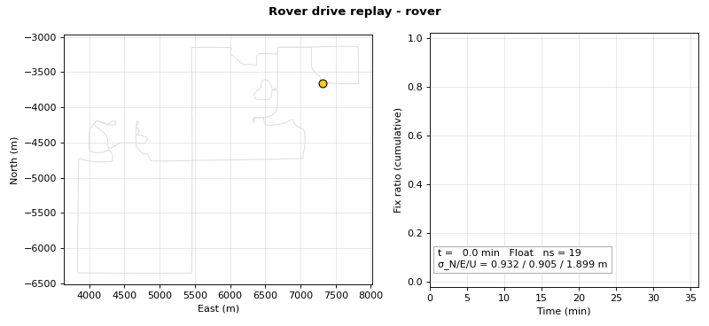

</div>

---

## Contents

1. [What it does](#what-it-does)
2. [Results on the sample data](#results-on-the-sample-data)
3. [Quick start](#quick-start)
4. [How it works](#how-it-works)
5. [Project structure](#project-structure)
6. [Configuration](#configuration)
7. [Output files](#output-files)
8. [Plotting & figures](#plotting--figures)
9. [Sample datasets](#sample-datasets)
10. [Troubleshooting](#troubleshooting)
11. [Credits & license](#credits--license)
12. [Tóm tắt tiếng Việt](#tóm-tắt-tiếng-việt)

---

## What it does

Given **rover** observations, **base station** observations and **broadcast
ephemeris** (all RINEX), the engine estimates the rover position at every epoch
relative to the base, resolving carrier-phase integer ambiguities to reach
cm-level accuracy.

| Feature | Details |
|---|---|
| Constellations | GPS, GLONASS, Galileo (QZSS decoded) |
| Frequencies | single or dual (L1 + L2 / E5b, or L1 + L5 for phones) |
| Modes | `kinematic` / `static`; `forward`, `backward`, `combined`, `combined_noreset` |
| Estimator | Extended Kalman filter: position, velocity, acceleration + one phase bias per sat/freq |
| Observables | double-differenced pseudorange and carrier phase |
| Cycle slips | receiver LLI flags, Doppler-vs-phase, geometry-free combination |
| Ambiguity resolution | Modified LAMBDA (MLAMBDA), ratio test, partial fixing, fix-and-hold, min-lock |
| Extras | GLONASS inter-channel HW bias, base-obs interpolation, outlier rejection, RTKLIB-format `.pos` / `.pos.stat` / trace output |
| Dependencies | **NumPy** only for processing, **Matplotlib** for plots |

---

## Results on the sample data

u-blox F9P rover in a car around Boulder, Colorado (2020-12-24), base station
**TMG2** (Septentrio PolarX5), forward Kalman filter, `config_f9p.py`.

| Metric | RTKLIB-Py (this repo) | RTKLIB demo5 b34d (reference) |
|---|---:|---:|
| Epochs (1 Hz) | 2163 (36 min) | 2163 |
| Fix rate (Q = 1) | **58.8 %** | 79.8 % |
| Median σ N / E / U when fixed | 0.5 / 0.5 / 1.1 cm | – |
| Baseline length | 5.9 – 8.6 km | – |
| Path length | ≈ 21 km | – |
| Satellites used | 13 – 23 (median 21) | – |
| Difference to demo5, both fixed (RMS E / N / U) | 6.1 / 3.8 / 15.2 cm | – |
| Run time (single core, Python 3.10) | ≈ 4 min | – |

<table>
<tr>
<td>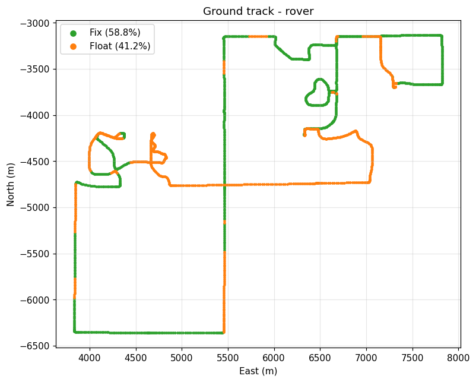</td>
<td>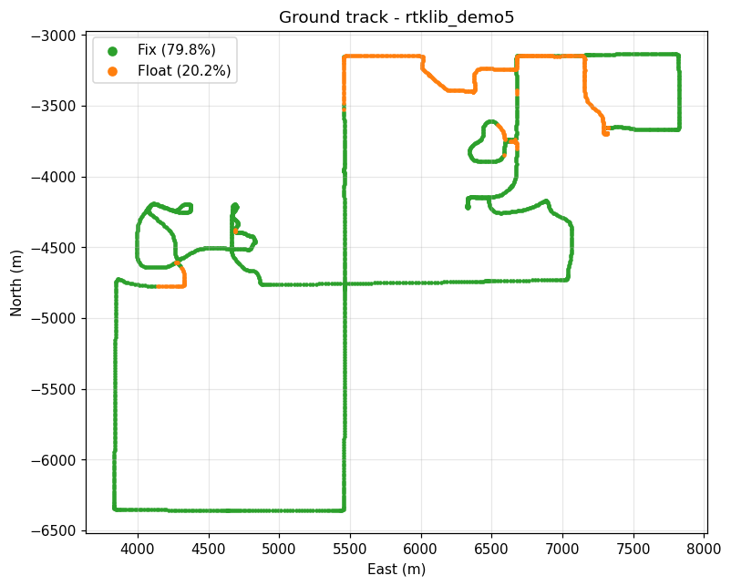</td>
</tr>
<tr>
<td align="center"><b>RTKLIB-Py</b> — green = fix, orange = float</td>
<td align="center"><b>RTKLIB demo5</b> on the same data</td>
</tr>
</table>

<div align="center">
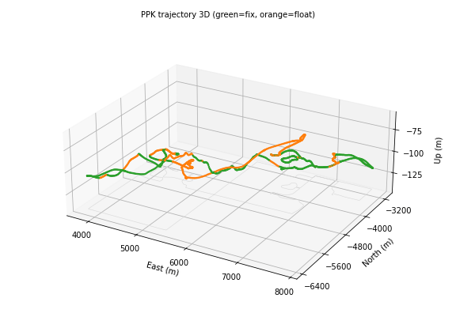
<br><em>3D trajectory (height exaggerated ≈ 17×)</em>
</div>

<details>
<summary><b>More plots</b> (ENU, quality, comparison, skyplot, velocity, acceleration)</summary>

**ENU position vs time** (origin = base station)
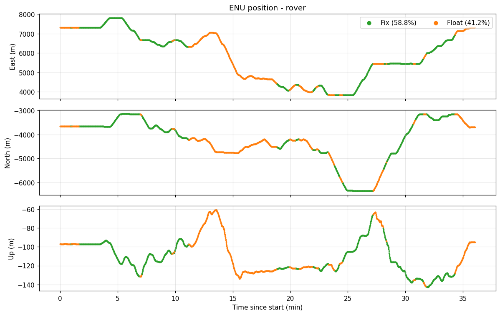

**Solution quality** — satellites, formal std-dev, AR ratio
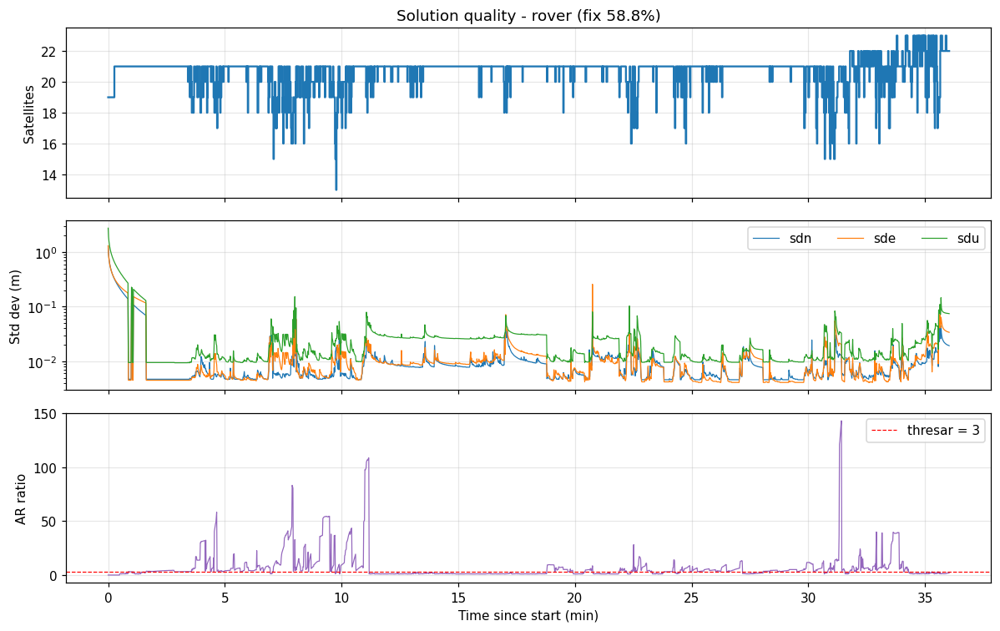

**Difference vs RTKLIB demo5**
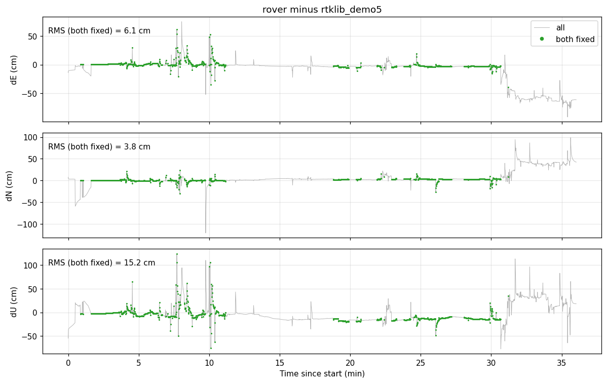

**Skyplot of satellites used by the rover**
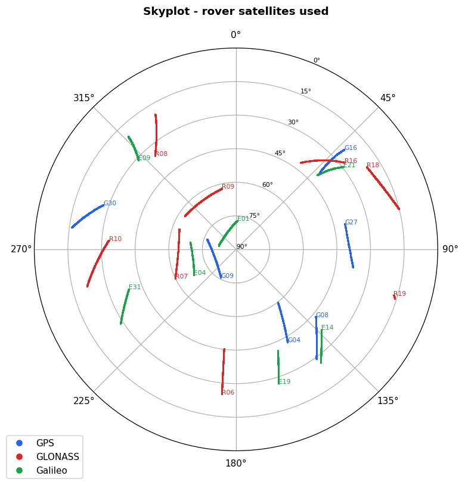

**3D trajectory**
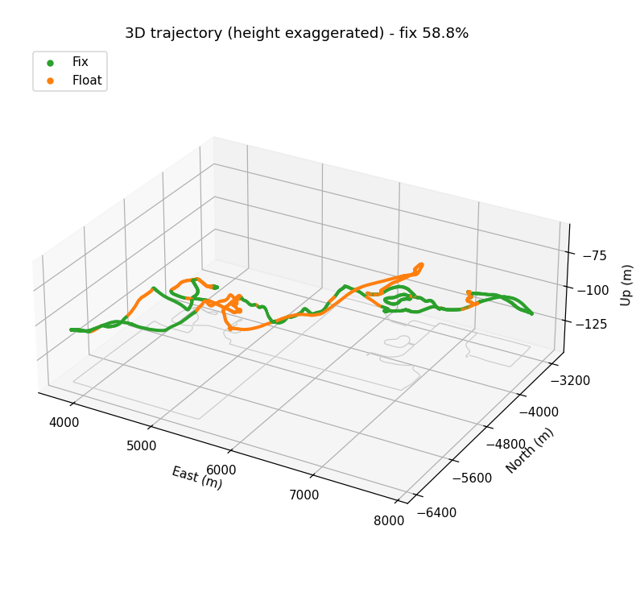

**Velocity / acceleration** (numerical derivatives of position)
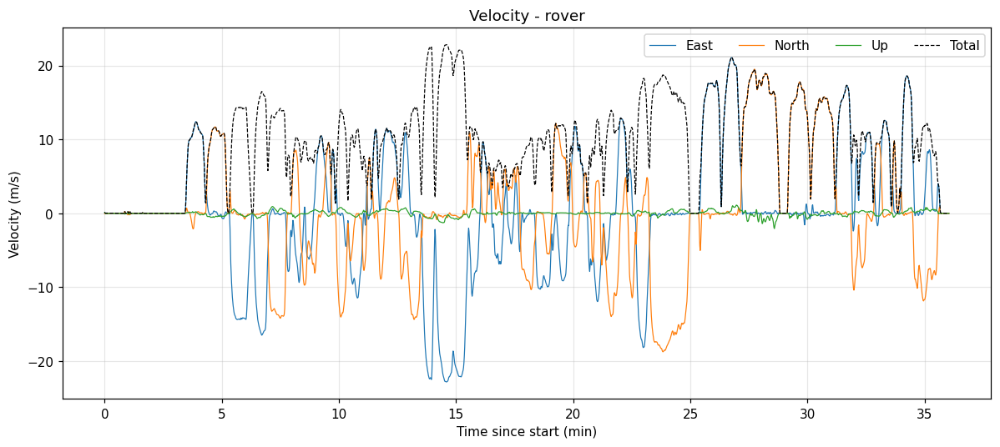
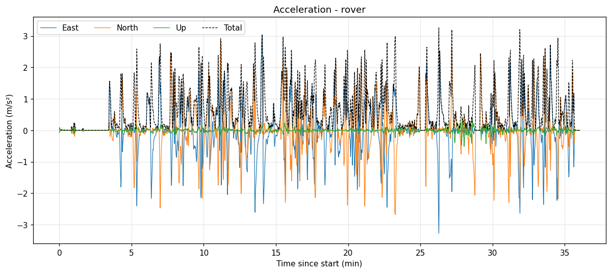

</details>

---

## Quick start

```bash
git clone https://github.com/khanhnger77/PPK.git
cd PPK
python -m pip install -r requirements.txt     # numpy, matplotlib

# 1) run PPK on the u-blox sample (writes data/u-blox/rover.pos)
cd src
python run_ppk.py
cd ..

# 2) plot the result
python plot/plot_ppk.py                                   # all plots, interactive
python plot/plot_ppk.py all --ref data/u-blox/rtklib_demo5.pos --save out/
```

Use your own data by editing the input block at the top of
[`src/run_ppk.py`](src/run_ppk.py):

```python
datadir  = '../data/u-blox'   # folder with the RINEX files
navfile  = 'rover.nav'        # broadcast ephemeris
rovfile  = 'rover.obs'        # rover observations
basefile = 'tmg23590.obs'     # base observations
cfgfile  = 'config_f9p.py'    # processing options
trace_level = 3               # 0 = off (faster, no 40 MB .trace file)
basepos = []                  # [x, y, z] ECEF to override the RINEX header
```

---

## How it works

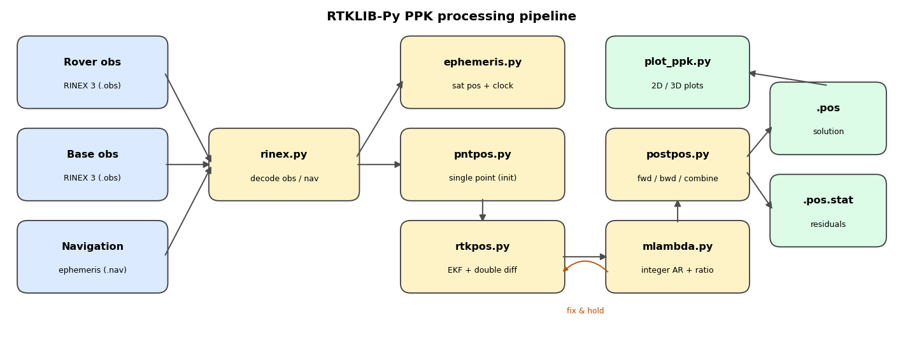

1. **Read RINEX** ([`rinex.py`](src/rinex.py)) — rover/base observations and GPS/GAL/GLO navigation messages; signals selected through `sig_tbl` and `freq_ix0/1`.
2. **Satellite states** ([`ephemeris.py`](src/ephemeris.py)) — satellite position, clock and health from broadcast ephemeris (Keplerian for GPS/GAL, RK4 orbit integration for GLONASS).
3. **Initial position** ([`pntpos.py`](src/pntpos.py)) — single-point least-squares solution with Klobuchar ionosphere and Saastamoinen troposphere models.
4. **Kalman filter** ([`rtkpos.py`](src/rtkpos.py)) — each epoch:
   * **time update** of position/velocity/acceleration (`udpos`) and of phase biases (`udbias`), with cycle-slip checks (LLI, Doppler, geometry-free);
   * **measurement update** with double-differenced residuals (`ddres`) and their covariance (`ddcov`), outlier rejection (`maxinno`, `maxcode`).
5. **Ambiguity resolution** ([`mlambda.py`](src/mlambda.py)) — float DD ambiguities are fixed with MLAMBDA; accepted if `ratio ≥ thresar`; with `armode = 3` fixed ambiguities are fed back as pseudo-measurements (*fix-and-hold*).
6. **Post-processing** ([`postpos.py`](src/postpos.py)) — forward and/or backward passes, combined by covariance-weighted smoothing; writes `.pos`.

### Double differencing

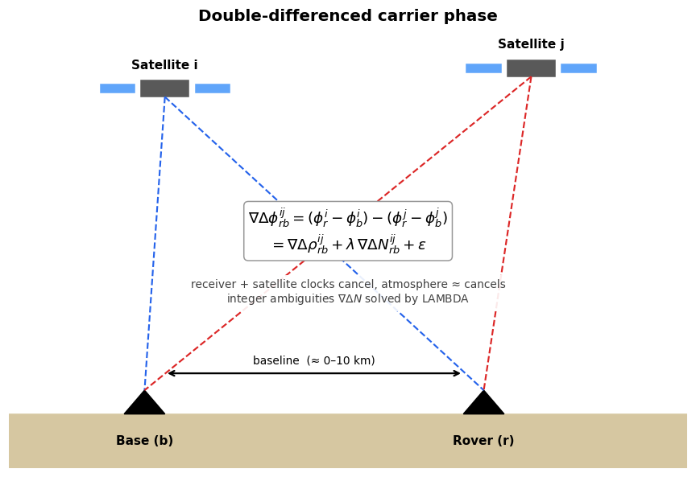

Subtracting the base from the rover (single difference) removes satellite
clock and most orbit / atmospheric errors; subtracting a reference satellite
(double difference) removes receiver clocks. What remains is the geometric
range, an **integer** number of cycles `∇ΔN` and noise. Once `∇ΔN` is fixed,
the carrier phase becomes a mm-precision range and the position is solved to
cm level.

### Kalman filter state

```
x = [ r_x r_y r_z | v_x v_y v_z | a_x a_y a_z | B_1,1 … B_nsat,nf ]
      position      velocity      acceleration   carrier-phase biases (m)
```

`static` mode keeps only the 3 position states. Process noise is set by
`accelh` / `accelv`; measurement noise by `err`, `eratio`, `efact` and
elevation / C/N0 weighting.

### Solution quality flags

| Q | Meaning |
|:-:|---|
| 1 | **Fix** — integer ambiguities resolved and validated |
| 2 | **Float** — ambiguities estimated as real numbers |
| 4 | DGPS — code only (too few valid phases) |
| 5 | Single point |

---

## Project structure

```
PPK/
├── src/                      # processing engine
│   ├── run_ppk.py            # entry point: choose files + config, run, save
│   ├── config_f9p.py         # options for u-blox F9P (L1/L2, fix-and-hold)
│   ├── config_phone.py       # options for smartphones (L1/L5, float only)
│   ├── postpos.py            # forward / backward / combined driver, .pos writer
│   ├── rtkpos.py             # EKF, double differences, cycle slips, AR control
│   ├── mlambda.py            # Modified LAMBDA integer least squares
│   ├── pntpos.py             # single-point positioning
│   ├── ephemeris.py          # satellite position / clock
│   ├── rinex.py              # RINEX obs / nav decoder, epoch sync
│   └── rtkcmn.py             # constants, time, coordinates, models, trace
├── plot/
│   └── plot_ppk.py           # CLI: track, ENU, velocity, accel, quality, compare
├── docs/
│   ├── make_figures.py       # regenerates every image in docs/images
│   └── images/               # PNG + GIF used in this README
├── data/
│   ├── u-blox/               # F9P rover + TMG2 base + nav + reference solutions
│   └── phone/                # Pixel 4 + SLAC base (Google SDC 2021)
├── requirements.txt
└── LICENSE
```

---

## Configuration

`run_ppk.py` copies the chosen config to `src/__ppk_config.py` (git-ignored)
which every module imports. Main options:

| Group | Option | F9P | Phone | Meaning |
|---|---|:-:|:-:|---|
| Mode | `nf` | 2 | 2 | number of frequencies |
| | `pmode` | kinematic | kinematic | `static` / `kinematic` |
| | `filtertype` | forward | forward | `forward`, `backward`, `combined`, `combined_noreset` |
| Masks | `elmin` | 15° | 15° | elevation mask |
| | `cnr_min` | [35, 35] | [28, 20] | min C/N0 per frequency (dB-Hz) |
| | `excsats` | [] | [] | excluded satellites, e.g. `['R10']` |
| Outliers | `maxinno` / `maxcode` | 1 / 10 m | 1 / 10 m | phase / code innovation threshold |
| Slips | `thresdop` / `thresslip` | 6 / 0.05 | 5 / 0.10 | Doppler / geometry-free thresholds |
| Noise | `eratio` | [300, 300] | [300, 100] | code / phase noise ratio |
| | `accelh` / `accelv` | 3 / 1 | 3 / 1 | horiz / vert accel noise (m/s²) |
| AR | `armode` | 3 | 0 | 0 off, 1 continuous, 3 fix-and-hold |
| | `thresar` | 3 | – | ratio-test threshold |
| | `minfix` / `minlock` | 20 / 0 | – | epochs before hold / before sat used in AR |
| | `glo_hwbias` | 0.0 | – | GLONASS inter-channel bias (m per frequency channel) |
| Signals | `freq_ix1` | L2 / G2 / E5b | L5 / G2 / E5a | second frequency per system |
| Positions | `rb` | [0,0,0] | [0,0,0] | base ECEF; zeros = RINEX header |

---

## Output files

Written next to the input data (`datadir`):

| File | Content |
|---|---|
| `rover.pos` | RTKLIB-format solution: time, lat, lon, height, Q, ns, σ, age, ratio |
| `rover.pos.stat` | per-epoch `$POS`, `$VELACC` and per-satellite `$SAT` lines (az, el, residuals, slip, lock, …) — compatible with RTKPLOT |
| `rover.trace` | debug trace (`trace_level` 1–5); ~40 MB at level 3 |
| `forward.pos`, `backward.pos`, `combined.pos` | per-direction solutions (`forward.pos` on every forward pass, the others in backward / combined modes) |

```
%  GPST                  latitude(deg) longitude(deg)  height(m)   Q  ns   sdn(m)   sde(m)   sdu(m)  sdne(m)  sdeu(m)  sdun(m) age(s)  ratio
2020/12/24 22:44:00.006   40.096655784 -105.147317348  1580.2125   2  22   0.0196   0.0342   0.0749  -0.0239  -0.0270   0.0169   0.01    1.8
```

`.stat`, `.trace`, `forward/backward/combined.pos` and `__ppk_config.py` are generated at run time and ignored by git.

---

## Plotting & figures

[`plot/plot_ppk.py`](plot/plot_ppk.py) reads any RTKLIB `.pos` file (NumPy + Matplotlib only):

```bash
python plot/plot_ppk.py [plots ...] [--pos FILE] [--base OBS|none] [--ref FILE] [--save DIR]
```

| Plot | Shows |
|---|---|
| `track` | East/North ground track coloured by Q |
| `enu` | E, N, U vs time coloured by Q |
| `vel` / `acc` | velocity / acceleration from numerical derivatives |
| `quality` | satellite count, σ N/E/U (log), AR ratio vs `thresar` |
| `compare` | E/N/U difference to `--ref` solution, RMS over common fixed epochs |
| `all` | all of the above (`compare` only when `--ref` is given) |

ENU origin is the `APPROX POSITION XYZ` of `--base` (default
`data/u-blox/tmg23590.obs`); `--base none` uses the first epoch.

To rebuild every image in this README (2D, 3D, GIFs, diagrams, skyplot):

```bash
cd src && python run_ppk.py && cd ..     # produces rover.pos + rover.pos.stat
python docs/make_figures.py              # ≈ 2 min
```

---

## Sample datasets

| Folder | Rover | Base | Notes |
|---|---|---|---|
| `data/u-blox` | u-blox ZED-F9P, car, 1 Hz, GPS + GLO + GAL, L1/L2/E5b | TMG2, Septentrio PolarX5 / JAVRINGANT_DM | `rtklib_demo5.pos` = RTKLIB demo5 b34d reference, `rover.pos` = this code |
| `data/phone` | Google Pixel 4, 1 Hz, L1/L5 | SLAC CORS | 2021 Google Smartphone Decimeter Challenge; switch the commented block in `run_ppk.py` |

---

## Troubleshooting

| Symptom | Things to try |
|---|---|
| Low fix rate | lower `elmin`/`elmaskar` carefully, raise `cnr_min`, try `filtertype = 'combined'`, check `thresar`, exclude bad sats with `excsats` |
| Wrong / jumping fixes | raise `thresar`, set `minlock` > 0, raise `minfix`, enable `glo_hwbias` or drop GLONASS |
| No solution | rover and base must overlap in time; check RINEX 3 signal codes vs `sig_tbl`; check base position (`rb` / header) |
| Very slow | set `trace_level = 0`; use `maxepoch` for quick tests |
| `Unable to import Axes3D` warning | mixed system/pip Matplotlib; harmless for `plot_ppk.py`, `make_figures.py` works around it |

---

## Credits & license

* Based on **[rtklib-py](https://github.com/rtklibexplorer/rtklib-py)** by Tim Everett, a Python port of the PPK parts of **[RTKLIB](https://github.com/tomojitakasu/RTKLIB)** (T. Takasu) / **[demo5](https://github.com/rtklibexplorer/RTKLIB)**.
* Built on **[CSSRLIB](https://github.com/hirokawa/cssrlib)** by Rui Hirokawa.
* MLAMBDA: X.-W. Chang, X. Yang, T. Zhou, *“MLAMBDA: a modified LAMBDA method for integer least-squares estimation”*, J. Geodesy 79, 2005.

Released under the [MIT License](LICENSE).

---

## Tóm tắt tiếng Việt

**PPK (Post-Processing Kinematic)** — xử lý sau dữ liệu GNSS của máy động (rover)
và trạm gốc (base) để có quỹ đạo chính xác cỡ cm. Toàn bộ thuật toán viết bằng
Python/NumPy theo RTKLIB: lọc Kalman mở rộng, sai phân kép (double difference),
phát hiện trượt chu kỳ, giải số nguyên đa trị bằng MLAMBDA + kiểm tra tỉ số
(ratio test) + fix-and-hold.

**Chạy nhanh**

```bash
pip install -r requirements.txt
cd src && python run_ppk.py && cd ..        # tạo data/u-blox/rover.pos
python plot/plot_ppk.py                     # vẽ quỹ đạo, ENU, chất lượng...
python docs/make_figures.py                 # tạo lại toàn bộ ảnh 2D/3D/GIF
```

**Kết quả mẫu (u-blox F9P, base TMG2, 36 phút, baseline 6–9 km):**
tỉ lệ Fix 58.8 % (RTKLIB demo5: 79.8 %), độ lệch chuẩn khi Fix ≈ 0.5 cm
ngang / 1.1 cm đứng, chênh lệch so với demo5 tại các epoch cùng Fix:
RMS 6.1 / 3.8 / 15.2 cm (E / N / U).

**Đổi dữ liệu:** sửa khối `datadir / navfile / rovfile / basefile / cfgfile`
ở đầu `src/run_ppk.py`; tham số xử lý nằm trong `src/config_*.py` (bảng
[Configuration](#configuration)).
